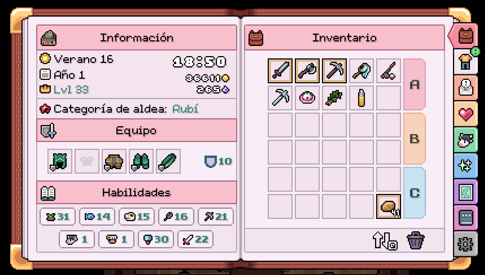

# Locked Inventory Slots

Locked Inventory Slots lets individual positions in the player inventory and player-owned storage chests opt out of Fields of Mistria's vanilla **Sort** operation. A lock belongs to the position, not the item: you can still move, replace, use, equip, consume, or discard its contents manually.

The mod does not replace the inventory or implement a custom category/order algorithm. It gives vanilla Sort only the unlocked positions, so locked stacks and locked empty spaces never enter its drain, merge, or reorder pass.

## Requirements

- Fields of Mistria 1.0.6, Steam build 25583279
- MOMI/MMAPI 0.16.5 or newer

Version 0.2.1 updates compatibility for the versions above. It preserves the player-inventory, toolbar, and ordinary storage-chest behavior introduced in 0.2.0. Strict lint, required compilation and in-game regression passed on 2026-10-10.

## Installation

1. Install MOMI/MMAPI and follow its setup instructions for Fields of Mistria.
2. Copy only the `locked_inventory_slots` directory into the game's `mods` directory.
3. Confirm that `mods/locked_inventory_slots/manifest.json` exists directly at that path.
4. Run MOMI and apply the mod.
5. Start the game and load a save.

## Using the mod

Open the vanilla Inventory page or a player-owned storage chest, then hold **Z** and **right-click** a space to lock or unlock it. In a chest, use its left-hand storage grid rather than the player-inventory grid on the right. A vanilla-style yellow border appears around the space.

- Locks belong to inventory positions, not items. Moving or replacing an item does not move its lock.
- Locked positions remain fully interactive: items can still be moved, replaced, equipped, used, consumed, or discarded manually.
- The lock affects only the vanilla **Sort** command for that inventory or chest. A locked stack stays in its exact position, and a locked empty position stays empty during Sort.
- Unlocked positions are still sorted by the original vanilla algorithm, including its normal stack merging and ordering.
- If every available position is locked, Sort leaves the inventory unchanged.
- The same locks and yellow borders appear on the corresponding toolbar page. Toolbar pages A, B, and C map to the matching groups of ten inventory positions.
- Player-inventory locks can be toggled only from the Inventory page, not directly from the toolbar. Chest locks are toggled in the open chest's left-hand grid.
- Each placed chest has an independent lock layout based on its location and tile. Moving a chest gives it a fresh layout at the new position; the old placement record remains in the sidecar and can be reused by a chest of the same type placed on that exact tile later.
- A successful toggle plays the normal UI click sound.
- `Shift + right-click` keeps its vanilla quick-transfer behavior, and `Ctrl + right-click` still performs vanilla's half-stack pickup action.
- With no locks—or with protection disabled—Sort runs exactly as vanilla.

### Screenshots




### Controller

Focus a space in the Player Inventory page or the left-hand grid of an open chest and press the **left stick button** (`L3`, by clicking the stick). The default device-agnostic MMAPI binding is:

```text
GAMEPAD_LEFT_STICK
```

The binding works only while a supported player-inventory or chest space is focused. Version 0.1.2 replaced the old `GAMEPAD_LEFT_SHOULDER+GAMEPAD_X` default because `LB` changes vanilla Journal and toolbar pages while `X` performs Pick Up One. Existing version-1 configs keep every other option and reset this controller binding once to `GAMEPAD_LEFT_STICK`; it can then be customized normally. An invalid value also falls back to the default.

To use the right stick button instead, close the game and set `controller_toggle_binding` to `GAMEPAD_RIGHT_STICK` in the config file. The keyboard gesture is fixed to `Z + right-click`; only the controller binding is configurable in version 0.2.0.

## Persistence

Locks are stored per save in MMAPI's JSON sidecar under:

```text
%LOCALAPPDATA%/FieldsOfMistria/mod_data/locked_inventory_slots/saves/
```

The vanilla save is never modified. Each save has its own player layout and independent records for placed chests. Chest identity uses the grid location, dynamic interior, tile coordinates, and chest type; the mod does not add IDs to vanilla furniture data. When the backpack expands, existing valid locks remain and newly added positions start unlocked. Duplicate, malformed, and out-of-range saved indices are discarded.

## Configuration

MMAPI creates:

```text
%LOCALAPPDATA%/FieldsOfMistria/mod_data/locked_inventory_slots/locked_inventory_slots.json
```

Available options:

| Option | Default | Effect |
| --- | --- | --- |
| `enabled` | `true` | Master switch. When disabled, toggling, indicators, and Sort protection are inactive; saved locks are retained. |
| `show_lock_border` | `true` | Shows the yellow border. Locks and Sort protection remain active when it is hidden. The old `show_lock_icon` option is migrated automatically. |
| `protect_from_sort` | `true` | Excludes locked player and chest positions from vanilla Sort. When disabled, locks remain saved and visible but do not affect Sort. |
| `controller_toggle_binding` | `GAMEPAD_LEFT_STICK` | Device-agnostic MMAPI binding used on the focused inventory space. Version-1 configs reset this field once to remove the conflicting legacy control; subsequent custom values are preserved. |
| `debug_logging` | `false` | Writes bounded lock and Sort diagnostics, including successful invariant checks, to the mod log. |

Restart the game after editing the config.

## Compatibility and limitations

- Only vanilla **Sort** for the player inventory and ordinary player-owned storage chests is changed. Shipping bins, quest turn-in containers, factories, feeders, and other special inventories are excluded.
- Quick Stack, transfers, crafting/consumption, and automatic item acquisition keep their vanilla behavior. A position lock is not a general item-protection or favorite-item system.
- A mod that replaces `PlayerMenu`, `StorageMenu`, `InventoryMenu.input_check`, or either affected inventory's `sort` method may conflict.
- Sort protection snapshots the inventory, gives vanilla Sort only the unlocked slot objects, then verifies the complete item/quantity/metadata multiset and every locked position. An exception or mismatch restores the pre-Sort snapshot and writes an error.
- Debug output is stored under `%LOCALAPPDATA%/FieldsOfMistria/mod_data/locked_inventory_slots/logs/` when logging is enabled. Safety errors are logged even when debug logging is disabled.
- English and Spanish (Spain) localization data are included. The Spanish wording follows vanilla's use of “espacios” for backpack capacity.

## Uninstallation

1. Close the game.
2. Remove `mods/locked_inventory_slots`.
3. Run MOMI again to reapply the remaining mods.

The per-save sidecars are harmless if left behind. Delete `mod_data/locked_inventory_slots` only if you also want to erase saved locks and configuration.

---

# Locked Inventory Slots — Español

Locked Inventory Slots permite excluir espacios concretos del inventario del jugador y de los cofres propios de la operación vanilla **Ordenar**. El bloqueo pertenece a la posición, no al objeto: puedes mover, sustituir, usar, equipar, consumir o tirar su contenido manualmente.

El mod no sustituye el inventario ni crea un algoritmo de ordenación propio. La función vanilla recibe únicamente los espacios desbloqueados; los espacios bloqueados, incluso vacíos, nunca entran en su proceso de vaciado, apilado u ordenación.

## Requisitos

- Fields of Mistria 1.0.6, compilación 25583279 de Steam
- MOMI/MMAPI 0.16.5 o posterior

## Instalación y uso

1. Instala MOMI/MMAPI siguiendo sus instrucciones para Fields of Mistria.
2. Copia únicamente la carpeta `locked_inventory_slots` dentro de la carpeta `mods` del juego.
3. Comprueba que `mods/locked_inventory_slots/manifest.json` exista exactamente en esa ruta.
4. Ejecuta MOMI y aplica el mod.
5. Inicia el juego y carga una partida.

Abre la página vanilla de Inventario o un cofre propio, mantén **Z** y haz **clic derecho** sobre un espacio para bloquearlo o desbloquearlo. En los cofres actúa sobre la cuadrícula izquierda, no sobre el inventario del jugador situado a la derecha. Un clic correcto reproduce el sonido habitual de la interfaz.

### Qué hace cada bloqueo

- El bloqueo pertenece a la posición, no al objeto. Mover o sustituir el objeto no desplaza el bloqueo.
- La posición sigue siendo completamente interactiva: puedes mover, sustituir, equipar, usar, consumir o tirar su contenido manualmente.
- El bloqueo afecta únicamente a **Ordenar** en ese inventario o cofre. Una pila bloqueada conserva su posición exacta y un espacio vacío bloqueado permanece vacío durante Ordenar.
- Los espacios desbloqueados siguen usando el algoritmo vanilla, incluido su apilado y orden habituales.
- Si todos los espacios disponibles están bloqueados, Ordenar no modifica el inventario.
- Los mismos bloqueos aparecen con borde amarillo en la página correspondiente de la barra. Las páginas A, B y C corresponden a los grupos de diez posiciones del inventario.
- Los bloqueos del inventario del jugador solo se pueden cambiar desde la página de Inventario, no directamente desde la barra. Los del cofre se cambian en su cuadrícula izquierda mientras está abierto.
- Cada cofre colocado conserva una distribución independiente según su ubicación y casilla. Al moverlo empieza desbloqueado en la nueva posición; el registro antiguo permanece en el archivo auxiliar y puede reutilizarse si más adelante se coloca un cofre del mismo tipo exactamente en esa casilla.
- Si no hay bloqueos o la protección está desactivada, Ordenar funciona exactamente como en el juego vanilla.
- `Mayús + clic derecho` conserva su transferencia rápida vanilla y `Control + clic derecho` sigue realizando la acción vanilla de recoger media pila.

### Mando

Enfoca un espacio en la página de Inventario o en la cuadrícula izquierda de un cofre abierto y pulsa el **botón del stick izquierdo** (`L3`, presionando el stick). El binding predeterminado de MMAPI es:

```text
GAMEPAD_LEFT_STICK
```

La versión 0.1.2 sustituye el antiguo binding `GAMEPAD_LEFT_SHOULDER+GAMEPAD_X`: `LB` cambia páginas vanilla del Diario y la barra, mientras que `X` ejecuta Recoger uno. Las configuraciones de versión 1 conservan todas las demás opciones y restablecen una sola vez este binding a `GAMEPAD_LEFT_STICK`; después puede personalizarse con normalidad. Un valor inválido también vuelve al predeterminado.

Para usar el botón del stick derecho, cierra el juego y cambia `controller_toggle_binding` a `GAMEPAD_RIGHT_STICK` en el archivo de configuración. El gesto de teclado está fijado a `Z + clic derecho`; en la versión 0.2.0 solo es configurable el binding del mando.

## Persistencia

Los bloqueos se guardan por partida en:

```text
%LOCALAPPDATA%/FieldsOfMistria/mod_data/locked_inventory_slots/saves/
```

El mod nunca modifica el guardado vanilla. Cada partida conserva su distribución del jugador y registros independientes para los cofres colocados. La identidad del cofre combina ubicación, interior dinámico, coordenadas y tipo, sin añadir campos al mobiliario vanilla. Al ampliar la mochila, los bloqueos válidos existentes se mantienen y las posiciones nuevas empiezan desbloqueadas. Los índices duplicados, inválidos o fuera del tamaño real se descartan.

## Configuración

MMAPI crea `%LOCALAPPDATA%/FieldsOfMistria/mod_data/locked_inventory_slots/locked_inventory_slots.json`. Reinicia el juego después de editarlo.

| Opción | Predeterminado | Efecto |
| --- | --- | --- |
| `enabled` | `true` | Interruptor general. Al desactivarlo no se puede alternar bloqueos y se ocultan los indicadores y la protección; los bloqueos guardados se conservan. |
| `show_lock_border` | `true` | Muestra el borde amarillo. Ocultarlo no desactiva los bloqueos ni su protección. Migra automáticamente la antigua opción `show_lock_icon`. |
| `protect_from_sort` | `true` | Excluye de Ordenar las posiciones bloqueadas del jugador y de los cofres. Al desactivarlo, los bloqueos siguen guardados y visibles, pero Ordenar no los respeta. |
| `controller_toggle_binding` | `GAMEPAD_LEFT_STICK` | Binding MMAPI para alternar el espacio enfocado con mando. Las configuraciones v1 restablecen este campo una vez para eliminar el control antiguo en conflicto. |
| `debug_logging` | `false` | Escribe diagnósticos limitados de bloqueos, operaciones de Ordenar y comprobaciones de integridad. |

## Compatibilidad, seguridad y límites

- Solo cambia **Ordenar** en el inventario del jugador y los cofres ordinarios que le pertenecen. Excluye contenedores de envío, entregas de misión, fábricas, comederos y otros inventarios especiales.
- Quick Stack, transferencias, fabricación/consumo y adquisición automática conservan su comportamiento vanilla. No es un sistema general de favoritos o protección de objetos.
- Puede entrar en conflicto con otro mod que sustituya `PlayerMenu`, `StorageMenu`, `InventoryMenu.input_check` o el método `sort` de los inventarios afectados.
- Antes de Ordenar crea una instantánea, entrega al algoritmo vanilla únicamente las posiciones desbloqueadas y después verifica el conjunto completo de objetos, cantidades y metadatos, además de cada posición bloqueada. Si ocurre una excepción o una discrepancia, restaura la instantánea y registra el error.
- Los diagnósticos se guardan en `%LOCALAPPDATA%/FieldsOfMistria/mod_data/locked_inventory_slots/logs/`. Los errores de seguridad se registran aunque `debug_logging` esté desactivado.
- Incluye datos de localización en inglés y español de España.

## Desinstalación

1. Cierra el juego.
2. Elimina `mods/locked_inventory_slots`.
3. Ejecuta MOMI otra vez para volver a aplicar los demás mods.

Los archivos auxiliares por partida no causan ningún problema si permanecen ahí. Elimina `mod_data/locked_inventory_slots` únicamente si también quieres borrar todos los bloqueos guardados y la configuración.

## Compatibility refresh / Actualización de compatibilidad — 0.2.1

Fields of Mistria 1.0.6 (Steam build 25583279), official MOMI/MMAPI 0.16.5. Compatibility-only update; config and per-save schemas remain unchanged. Strict lint and required compilation pass. In-game regression passed on 2026-10-10.

Actualización de compatibilidad; conserva las funciones, la configuración y los datos auxiliares por partida. Lint estricto y compilación obligatoria correctos. La prueba en juego se confirmó el 2026-10-10.
